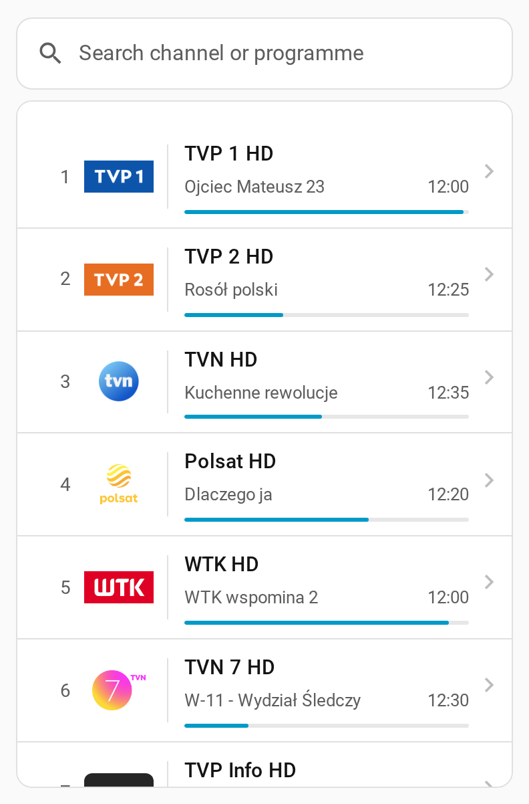
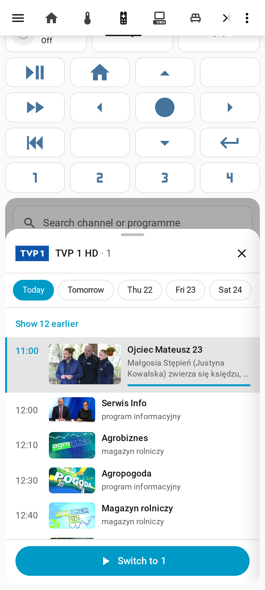
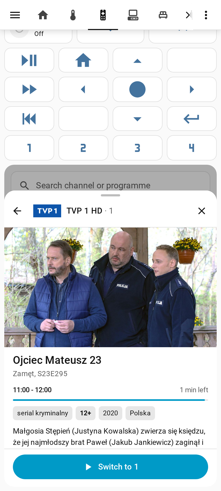

# TV guide for Home Assistant


[](https://hacs.xyz)
[](https://github.com/dariuszpaluch/ha-tv-guide/releases)
[](https://github.com/dariuszpaluch/ha-tv-guide/actions/workflows/ci.yml)
[](LICENSE)

A TV guide in your Home Assistant dashboard: what is on now, what comes next, the schedule for the next days, and search in channels and programmes. A tap switches your TV or cable box to the channel with any Home Assistant action: a script, a remote or a media player.

| Channel list | Channel schedule | Programme details |
| --- | --- | --- |
|  |  |  |

## Features

- Channel list with the programme on now and a progress bar. Group the channels in sections.
- Schedule for each day, with posters. A TV day starts at 05:00, like in a printed guide.
- Programme details: poster, description, category, age rating, year, and more airings of the same programme.
- Search in channels, programmes on now and programmes later.
- Switch the channel with one tap. Any Home Assistant action works.
- Works with any [XMLTV](https://wiki.xmltv.org/index.php/XMLTVFormat) guide, plain or compressed.
- Keeps the last good guide on disk, so the card works when the guide source is down.
- Follows your Home Assistant theme, language (English or Polish), time format and time zone.

It has two parts, installed together:

- **Integration `tv_guide`** downloads the guide, keeps the channels you select and answers the card. It keeps the last good guide and the posters on disk.
- **Card `custom:tv-guide`** shows the guide. The integration adds the card to your dashboards, so you do not add a Lovelace resource.

## Requirements

- Home Assistant 2026.10 or newer.
- [HACS](https://hacs.xyz), for the normal install.
- The URL of an XMLTV guide, plain or compressed (`.gz`, `.xz`, `.zip`). See [Find a guide](#find-a-guide).

You do not install other packages. The integration uses only what Home Assistant already has.

## Install

### With HACS

[](https://my.home-assistant.io/redirect/hacs_repository/?owner=dariuszpaluch&repository=ha-tv-guide&category=integration)

1. In HACS, open the menu → **Custom repositories**. Add `https://github.com/dariuszpaluch/ha-tv-guide` with the type **Integration**.
2. Install **TV guide** and restart Home Assistant.

### By hand

1. Download `tv_guide.zip` from the [latest release](https://github.com/dariuszpaluch/ha-tv-guide/releases/latest).
2. Unpack it into `<config>/custom_components/tv_guide/`.
3. Restart Home Assistant.

## Set up

### 1. Add the integration

Go to **Settings → Devices & services → Add integration → TV guide**. Enter the XMLTV URL, then select your channels.

| Option | Default | Description |
| --- | --- | --- |
| XMLTV URL | - | Source of the guide. |
| Channels | - | The channels to keep. Only these are in memory and on disk. |
| Update interval | 12 h | How often the guide is downloaded. |

To change the channels or the interval later, open the integration and select **Configure**.

### 2. Make your channel list

The channels are in two places. The integration keeps the guide of the channels you select. The card lists them with the numbers of your box. Both use the same guide id (`epg_id`).

1. Start from [examples/card.yaml](examples/card.yaml). It has about 40 popular channels of the Polish guide [epg.ovh](https://epg.ovh) with the right ids.
2. Change `number` to the numbers of your box. Delete the channels you do not have.
3. In the integration options, select the same channels.

To add a channel that is not in the example, select it in the integration options and copy its guide id into the card. The channel list in the options shows `Name (id: ...)` when the id is not the same as the name.

### 3. Add the card

Edit a dashboard, add a card, choose **Manual** and paste your config:

```yaml
type: custom:tv-guide
switch_action:               # any HA action; {number} is replaced with the channel number
  perform_action: script.cable_box_go_to_channel
  data:
    channel: "{number}"
sections:
  - title: Main
    channels:
      - number: 1
        name: TVP 1 HD
        epg_id: TVP 1         # channel id in the XMLTV guide
      - number: 3
        name: TVN HD
        epg_id: TVN
        logo: /local/images/tv-logos/tvn.png   # optional, default is the icon from the guide
```

## Card options

| Option | Default | Description |
| --- | --- | --- |
| `switch_action` | - | Action that switches the channel. It takes `perform_action` and `data` only. `{number}` in `data` becomes the channel number. |
| `sections` | - | Groups of channels in the list. Each section has `channels` and an optional `title`. |
| `entry_id` | first guide | The `tv_guide` entry to use, when you have more than one guide. |
| `tv_day_starts_at` | `5` | Hour when a TV day starts. Programmes after midnight belong to the evening before. |
| `height` | `600px` | Height of the whole card: the search box and the list. |

Each channel has:

| Key | Required | Description |
| --- | --- | --- |
| `number` | yes | Channel number on your box. A whole number, or text in quotes, such as `"5.1"`. |
| `name` | yes | Name shown in the list. |
| `epg_id` | no | Channel id in the XMLTV guide. Without it, or when the guide has no data for it, the channel shows "No guide". |
| `logo` | no | URL of a logo. It wins over the icon from the guide. |
| `logo_tile` | no | `dark` or `light`: the tile behind the logo. By default the card picks a tile that contrasts with the logo. |

### Switch action

`switch_action` takes `perform_action` and `data`. Put the entity in `data`, as `entity_id`. The `target:` key is not supported.

A remote:

```yaml
switch_action:
  perform_action: remote.send_command
  data:
    entity_id: remote.living_room
    command: "{number}"
```

A media player:

```yaml
switch_action:
  perform_action: media_player.play_media
  data:
    entity_id: media_player.living_room_tv
    media_content_type: channel
    media_content_id: "{number}"
```

## Find a guide

The integration works with any XMLTV guide. Nothing in it is tied to one country.

- Poland: [epg.ovh](https://epg.ovh), for example `https://epg.ovh/pl.gz`.
- France: [xmltvfr.fr](https://xmltvfr.fr).
- Other countries: build a guide with [iptv-org/epg](https://github.com/iptv-org/epg).
- Many IPTV providers give an XMLTV URL. The URL you use in Kodi, Tvheadend or Jellyfin works here too.

Outside Poland:

- Channel numbers can be text, for example a US sub-channel: `number: "5.1"` (in quotes, so YAML keeps it as text).
- Age ratings show as the guide gives them (`PG-13`, `FSK 12`). A plain number such as `12` shows as `12+`.
- The card is in English and Polish. Other languages get English. Translations are welcome, see [CONTRIBUTING.md](CONTRIBUTING.md#add-a-language).
- [examples/card.yaml](examples/card.yaml) is for the Polish guide. For another guide, copy the channel ids from the integration options.

## How the guide updates

- The integration downloads the guide when you add it, then every update interval (12 hours by default, 1 to 48 hours).
- It keeps the last good guide on disk. After a restart it uses that copy at once, then downloads a new one.
- When a download fails, the card keeps the current guide, and HA logs an error (once, until a download works again). When the last good download is older than two update intervals, the card shows "Guide from <date, time>" above the list.
- The card asks the integration for new data every 60 seconds, so the programme on now moves on by itself.
- When you select a new channel in the options, it gets its programmes from the download that runs right after you save.
- Posters are downloaded the first time someone opens them. Copies not used for 7 days are deleted.

## Known limitations

- There is no "yesterday": a cable box cannot play past programmes.
- The card is in English and Polish. Other languages get English.
- The guide download can be at most 64 MB (compressed).
- You cannot change the guide URL of an added guide. Delete the guide and add it again.
- One card switches one TV: `switch_action` is the same for all channels of a card. For a second TV, add a second card.
- If your Home Assistant uses https (for example Nabu Casa), the browser can block a channel logo that the guide gives with plain `http`. Set `logo` for those channels.

## Troubleshooting

| You see | What to do |
| --- | --- |
| "The guide is not loaded yet." | The integration has not downloaded the guide yet. Wait a moment. If it stays, check the logs (Settings → System → Logs) and the guide URL. |
| "Add the TV guide integration first." | Add the integration: Settings → Devices & services → Add integration → TV guide. |
| "No guide" on a channel | The `epg_id` in the card does not match a channel id in the guide. Open the integration options: the list shows `Name (id: ...)` when the id is not the name. |
| "Not selected in the integration" | Select the channel in the integration options. |
| "Guide from <date, time>" | The downloads fail. Check the logs and the guide URL. |
| "Cannot switch to ...: ..." | The switch action failed. Try the same action in Developer tools → Actions, with a channel number in place of `{number}`. |
| The card is missing or old after an update | Reload the page. In the HA app: Settings → Companion app → Debugging → Reset frontend cache. |

### Debug logs

Open Settings → Devices & services → TV guide, then select ⋮ → **Enable debug logging**. Or add this to `configuration.yaml` and restart:

```yaml
logger:
  logs:
    custom_components.tv_guide: debug
```

### Diagnostics

Open Settings → Devices & services → TV guide, then select ⋮ → **Download diagnostics**. The file shows the selected channels, the number of programmes per channel, the last download and the last error. It names only the server of the guide URL, not its path or query, so a login in the URL stays private.

### Report a bug

[Open an issue](https://github.com/dariuszpaluch/ha-tv-guide/issues/new/choose). Add the diagnostics file and the debug log.

## Remove

1. Remove the TV guide card from your dashboards.
2. Open Settings → Devices & services → TV guide, then select ⋮ → **Delete**. This deletes the stored guide. When you delete the last guide, the cached posters are deleted too.
3. In HACS, open TV guide and select **Remove**. If you installed by hand, delete `<config>/custom_components/tv_guide/`.
4. Restart Home Assistant.

## Data and images

This project contains code only. It has no guide data, posters or logos, and it does not share them.

- You choose the guide source. The guide data, the posters and the logos belong to their owners (the guide provider, broadcasters, picture agencies). Follow the terms of the source you use.
- The integration downloads the guide to your own Home Assistant. It downloads a poster only when someone opens it, keeps a small copy for your Home Assistant only, and deletes copies not used for 7 days. HA backups do not include these copies.
- The poster address works without a login, because an `` tag cannot send a token. It serves only posters of the guide you loaded, under ids that cannot be guessed. Do not use the integration to give the guide or the posters to other people.
- The integration downloads posters from any address the guide names, also inside your network. Use only a guide source you trust.
- The built card includes [Lit](https://lit.dev) (BSD-3-Clause). Its licence text is in `frontend/THIRD_PARTY_LICENSES.md` in the release zip.

## Contributing

Bug reports and pull requests are welcome. [CONTRIBUTING.md](CONTRIBUTING.md) tells you how to set up the project, test a change and add a language. [docs/design.md](docs/design.md) tells how it works.

## License

MIT, see [LICENSE](LICENSE).
